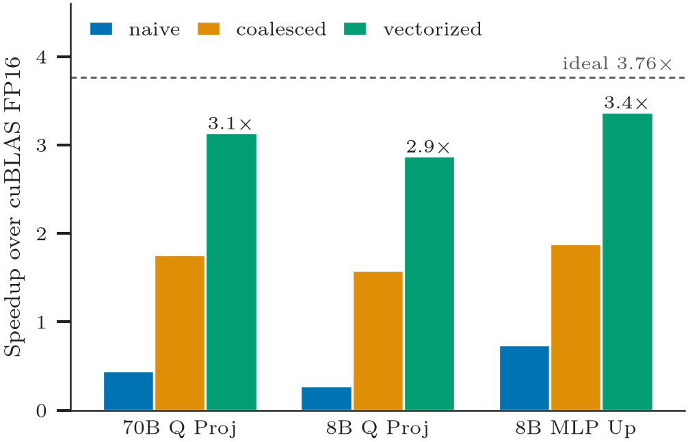
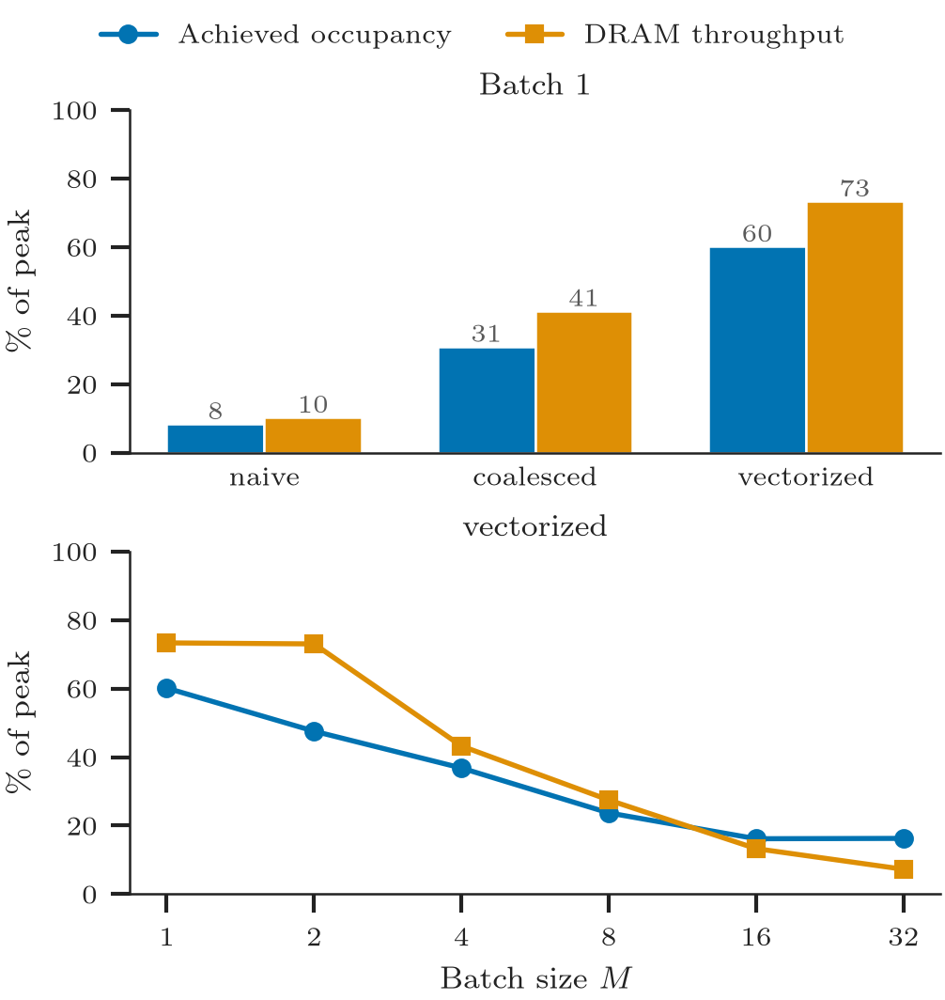
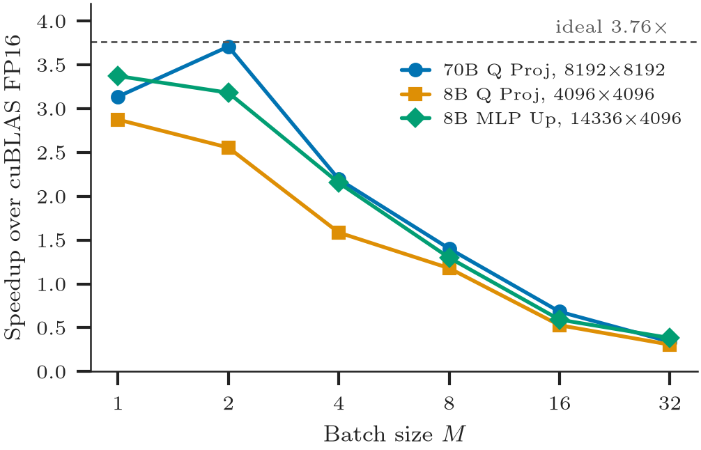

INT4 GEMV Kernels in CUDA
=======================
CUDA kernels for W4A16 GEMV (4-bit weights, FP16 activations), compared with FP16 cuBLAS on an RTX 3090. The weights stay packed in memory and are unpacked in registers inside the kernel. At batch 1, our fastest kernel is **2.9–3.4× faster than FP16 cuBLAS** on real Llama-3 weight matrices, close to the 3.76× limit set by the byte savings.

Kernels
------------
Weights are quantized with plain round-to-nearest to 4 bits, in groups of 128 with an FP16 scale and zero per group, and packed eight to a 32-bit word (`int4gemv/quant.py`).

| Kernel | Mapping |
| --- | --- |
| `naive` | One thread per output row |
| `coalesced` | One warp per row; neighbouring lanes read neighbouring words; warp-shuffle reduction |
| `vectorized` | Like `coalesced`, with 16-byte loads, 2 rows per warp and 4-warp blocks |

Results
------------
RTX 3090, default clocks. Weights are real Llama-3 matrices: layer 40 Q projection of Llama-3-70B (70B), and layer 16 Q projection and MLP up projection of Llama-3-8B (8B). Batch 1, time per call:

| | 70B Q Proj, 8192 × 8192 | 8B Q Proj, 4096 × 4096 | 8B MLP Up, 14336 × 4096 |
| --- | --- | --- | --- |
| cuBLAS FP16 | 164 µs | 47 µs | 149 µs |
| `naive` | 371 µs | 171 µs | 201 µs |
| `coalesced` | 93 µs | 30 µs | 79 µs |
| `vectorized` | **52 µs** | **16 µs** | **44 µs** |
| speedup over cuBLAS | **3.14×** | **2.88×** | **3.37×** |

<p align="center">
  
  <br>
  <em>Figure 1: Speedup over cuBLAS FP16 at batch 1. The dashed line is the 3.76× limit set by the byte savings.</em>
</p>

<p align="center">
  
  <br>
  <em>Figure 2: Achieved occupancy and DRAM throughput from Nsight Compute, 70B Q Proj. Top: each kernel at batch 1. Bottom: <code>vectorized</code> as the batch grows.</em>
</p>

<p align="center">
  
  <br>
  <em>Figure 3: Speedup of <code>vectorized</code> over cuBLAS FP16 as batch size grows.</em>
</p>

Repository Layout
------------
```
csrc/        CUDA kernels (naive.cu, coalesced.cu, vectorized.cu), loads-only diagnostic,
             input checks, CPU version, pybind bindings
int4gemv/    Quantize/pack, Python reference, loader for the built module
bench/       Timing harness, real-layer loader, batch sweep, block-size sweep, loads-only test,
             Nsight Compute profile, plots
```

Dependencies
------------
- NVIDIA GPU (measured on sm_86; builds for sm_86 and sm_89), CUDA ≥ 12.6, GCC ≥ 11, CMake ≥ 3.26, Ninja
- LaTeX, for the plot fonts (optional)
- [uv](https://docs.astral.sh/uv/) for Python; installs PyTorch 2.14.1 (cu126), matplotlib and seaborn

Usage
-----
```bash
uv sync
uv run cmake --preset release && uv run cmake --build --preset release
uv run python -m bench.sweep          # every kernel and cuBLAS, 3 matrices, M = 1..32
uv run python -m bench.block_sweep    # vectorized: threads per block × rows per warp, M = 1 and 8
uv run python -m bench.ceiling        # vectorized vs. its loads alone
uv run python -m bench.profile        # Nsight Compute counters; needs profiler access
uv run python -m bench.plot           # figures from outputs/*.csv into plots/
```
